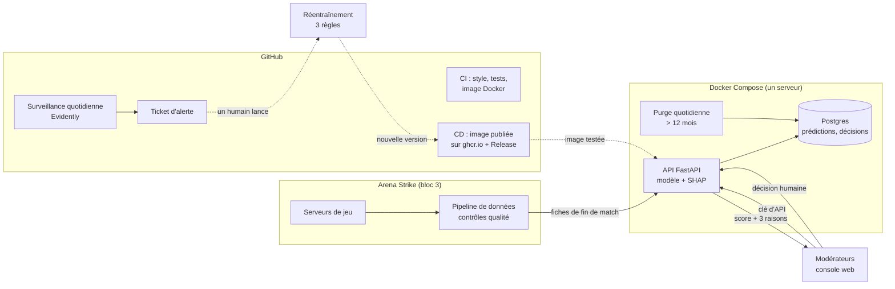

# Architecture — Sentinel (bloc 4)

## Vue d'ensemble



## Composants

| Composant | Rôle | Technologie | Pourquoi ce choix |
|---|---|---|---|
| Modèle | Score de suspicion par fiche | scikit-learn (gradient boosting) | Meilleure PR-AUC que la régression logistique, rapide, s'explique avec SHAP |
| Explications | 3 raisons en français | SHAP | Méthode de référence, calcul exact pour les arbres |
| API | Sert le modèle, journalise, droits RGPD | FastAPI + Pydantic | Validation automatique des entrées, documentation `/docs` générée |
| Base | Journal des prédictions et des décisions | Postgres 16 | Standard, gratuit, partagé avec le bloc 2 |
| Console | File de revue et fiches pour les modérateurs | HTML / CSS / JavaScript servis par l'API | Aucun outil ni ressource externe |
| Conteneurs | Démarrage identique partout | Docker, Docker Compose | Un serveur, 3 services : Kubernetes serait disproportionné |
| CI/CD | Tests à chaque modification, publication des versions | GitHub Actions, ghcr.io | Intégré au dépôt, gratuit |
| Surveillance | Dérive des données et de la performance | Evidently + GitHub Actions planifié | Rapport HTML prêt à l'emploi, alerte par ticket |
| Réentraînement | Nouveau modèle si meilleur et équitable | Script Python (`retrain/`) | Même méthode que v1, 3 règles explicites |

## Flux d'une prédiction

1. Le pipeline (bloc 3) ou la console envoie des fiches à `POST /predict` avec la clé d'API.
2. Pydantic vérifie chaque champ ; une donnée invalide est refusée (422, message en français).
3. Le modèle calcule les scores, SHAP les 3 raisons ; les fiches sont triées.
4. La prédiction est journalisée dans Postgres (sans variable d'audit). Si la base est en
   panne, la réponse part quand même et l'incident est journalisé.
5. Le modérateur examine la fiche et enregistre sa décision : le modèle ne sanctionne jamais.

## Cycle de vie du modèle

```
entraînement (src/model.py) → fiche JSON + échantillon de référence → CI → version publiée (CD)
      ↑                                                                          ↓
réentraînement (retrain/) ← un humain ← ticket ← surveillance quotidienne (monitoring/)
```

## Lien avec les autres blocs

| Bloc | Rôle pour Sentinel |
|---|---|
| Bloc 3 | Produit les fiches de fin de match, vérifie leur qualité, les envoie à l'API |
| Bloc 2 | Héberge la base Postgres et le tableau de bord Grafana (supervision) |
| Bloc 4 | Sert le modèle, le surveille et le réentraîne (ce dépôt) |
| Bloc 1 | Gouvernance : rôles, RGPD, mineurs, procédure de contestation |

## Évolutivité

L'API ne garde aucun état entre deux requêtes : on peut lancer plusieurs copies derrière un
répartiteur de charge. Une prédiction prend quelques millisecondes, et un lot de 1 000
fiches est traité en une requête. Pour aller plus loin (plusieurs serveurs, mise à
l'échelle automatique), on passerait à Kubernetes sans changer le code.
